# Evolving Prey

> A small side project I wrote a long time ago, and cleaned up recently.
> The first version is kept as is in [`original/`](original/).

A small **evolutionary algorithm** in Python and Tkinter. Blue balls are never told how to survive.
Each generation is rebuilt from the genomes that lasted the longest, and survival strategies emerge on their own.

Two challenges:
- **Predators**: survive red predators by evolving **size**, **speed** and **launch direction**
- **DVD mode**: bounce off the walls like the DVD logo and evolve the exact **launch angle** that keeps you on a deadly road

<p align="center">
  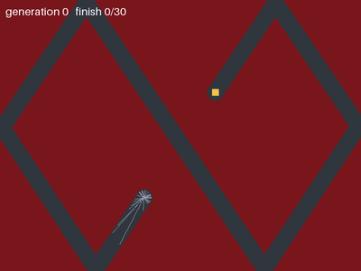
  <br><em>DVD mode: every trajectory of every generation. Starting from random angles, the population
  finds the one angle that stays on the road through 6 bounces.</em>
</p>

## How the evolution works

All challenges share the same recipe:

1. **Evaluate**: every ball is run, and its fitness is its **survival time** in frames
   (averaged over 5 runs with new random predators, so a lucky run doesn't decide the outcome).
2. **Recombine**: a parent genome is computed as the mean of all genomes, **weighted by `survival_time^5`**.
   The exponent makes the best individuals dominate. Directions are averaged as unit vectors
   (circular mean), because 359° and 1° are neighbours.
3. **Mutate (adaptive)**: each child = parent + exponential noise with a random sign. The noise scale is the
   **weighted spread of the population**. When the best individuals agree, the noise shrinks and the population
   tightens around them. When they disagree, or a gene doesn't matter, it stays large and keeps exploring.

This is close to the *weighted recombination* and *step-size adaptation* of evolution strategies such as
(μ/μ_w, λ)-ES, the cross-entropy method and CMA-ES.

## Challenge 1: Predators

Prey spawn in the center. Their genome is `(size, speed, direction)`.

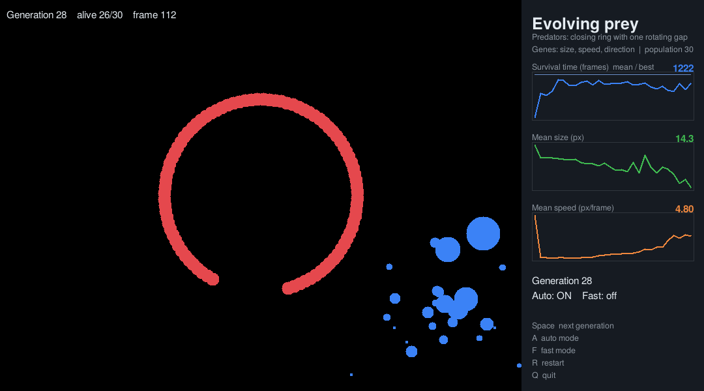

The strategy that evolves depends on how the predators move.

### Random predators: become tiny

A small target is harder to hit: size drops from 28 to 6 px within 10 generations. Speed and direction
have no clear effect here, so they stay noisy.

| Generation 0 | Generation 39 |
|:---:|:---:|
| 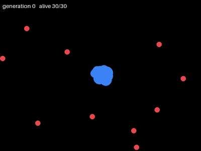 | 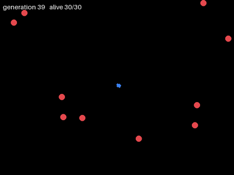 |

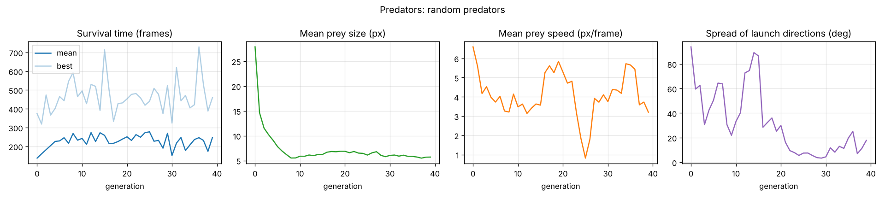

### Border patrol: stop moving

Predators slide along the walls, so the center is safe. Prey learn to **stand still**
(speed 6.6 → 0.1 px/frame within 5 generations). Almost all of them then survive the full run.
Size and direction no longer matter, so they drift freely.

| Generation 0 | Generation 39 |
|:---:|:---:|
| 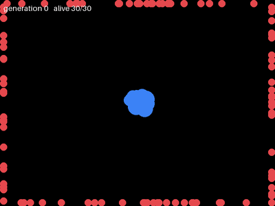 | 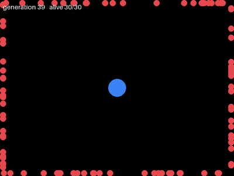 |

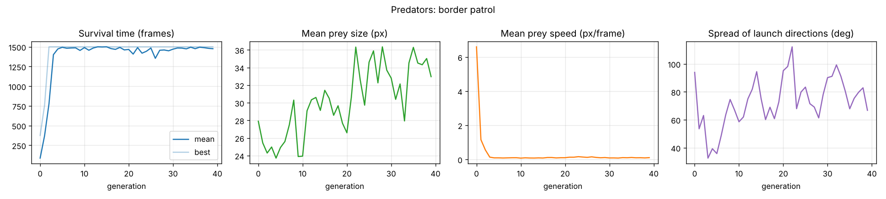

### Wave: run away at the right speed

A wall of predators sweeps from right to left, bounces off the left wall and comes back.
The best strategy is to flee left at **exactly the right speed**. Too slow, the wave catches you.
Too fast, you bounce off the wall and run back into it. Testing fixed strategies gives an optimum of
about 2.5 px/frame straight left (158 frames).
The population learns to go left (mean direction 178°) at about 3.5–4 px/frame. Since vertical motion
doesn't matter, only the horizontal component (≈ 3 px/frame) counts, close to the optimum.

| Generation 0 | Generation 39 |
|:---:|:---:|
| 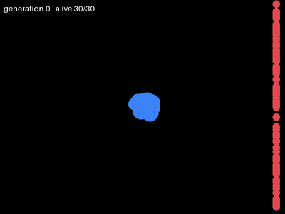 | 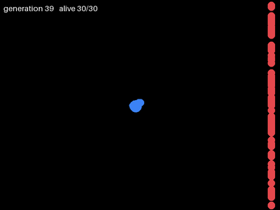 |

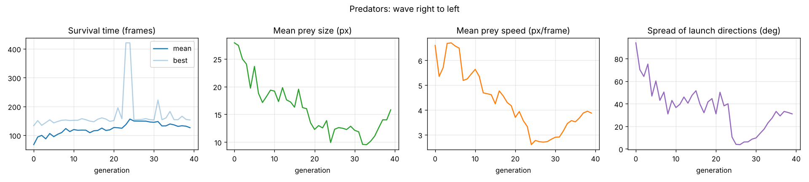

### Closing ring: aim for the door

A ring of predators closes on the prey, with one gap that **rotates** with it. Standing still is now deadly.
A prey must aim where the gap *will be* when it reaches the ring, so the right direction depends on its speed:
the two genes have to be learned together. Survival jumps from ~140 to ~1000+ frames within 5 generations as most of the population escapes
through the gap, and the spread of directions drops from 94° to under 10°.

| Generation 0 | Generation 39 |
|:---:|:---:|
| 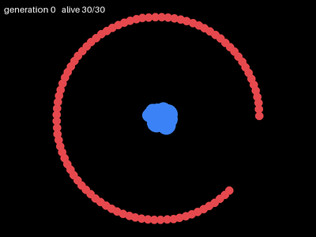 | 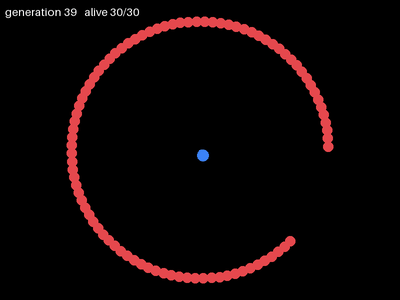 |

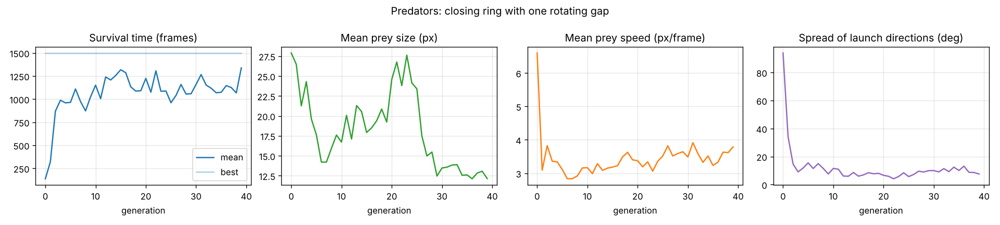

Other patterns are available (diagonals, waves in each direction, corner swarm, zigzag): `python viewer.py --help`.

## Challenge 2: DVD mode (orientation)

The only gene is the **launch angle**. Speed and size are fixed. Balls bounce off the window edges,
and touching the red area kills them. To reach the finish, a ball needs an angle that keeps it on the road
through every bounce, with a tolerance of about 0.3°.

The road is generated by launching a reference ball with a **secret angle**, so a perfect solution always
exists and we can measure the error. Roads whose parts come close to each other are rejected,
so the road never crosses itself.

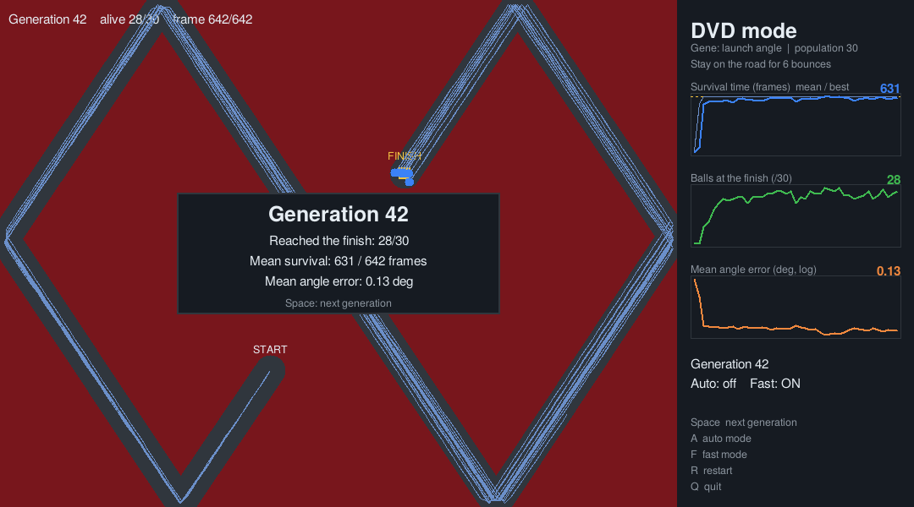

Starting from random angles (mean error ~90°), 22 of the 30 balls reach the finish by generation 5,
and the mean angle error drops to about 0.15°.

<p align="center">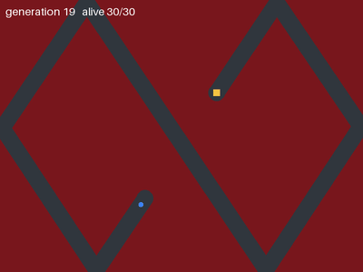</p>

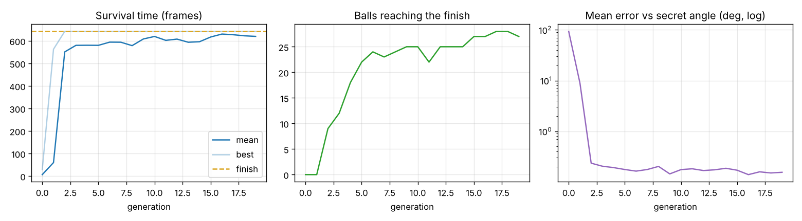

## Run it

Requires Python 3.9+ (Tkinter is included with Python on Windows and macOS; on Linux: `sudo apt install python3-tk`).

```bash
pip install -r requirements.txt

python orientation.py --view          # DVD mode, live
python viewer.py --pattern 9          # closing ring
python viewer.py --pattern 3          # wave
python viewer.py --pattern 2          # border patrol
python viewer.py --pattern 0          # random predators
```

**Keys in both viewers:** `Space` next generation · `A` auto mode · `F` fast mode · `R` restart · `Q` quit

Headless runs (fast, no window) save plots and GIFs in `results/`:

```bash
python train.py --pattern 9 --generations 40 --gif
python orientation.py --generations 20 --gif
```

## Project structure

```
simulation.py   predators challenge: agents, predator patterns, genome, adaptive evolution (no GUI)
orientation.py  DVD mode: track generation, evolution, plots, Tkinter view
viewer.py       live Tkinter view of the predators challenge
train.py        headless training of the predators challenge: CSV, plots, GIFs
gui.py          shared Tkinter helpers (live charts, keys, overlay)
original/       first version of the project, kept as is
```

## History

This started as a personal side project a long time ago (see `original/`). Revisiting it recently, I:
- separated the simulation from the display, so training can run headless about 100× faster
- made the mutation adaptive (spread of the best individuals) instead of a fixed schedule
- averaged fitness over several runs and counted it in frames rather than wall-clock time
- fixed several bugs: the size gene stopped evolving after generation 1, the drawn position drifted
  from the real one after bounces, and items were removed from a list while looping over it
- added DVD mode, the closing ring, live charts and an English interface

## Ideas

- Give prey sensors (distance to the nearest predator) and evolve a small neural network policy (neuroevolution)
- Compare with a classic GA (tournament selection + crossover) and with CMA-ES
- Co-evolve the predators
